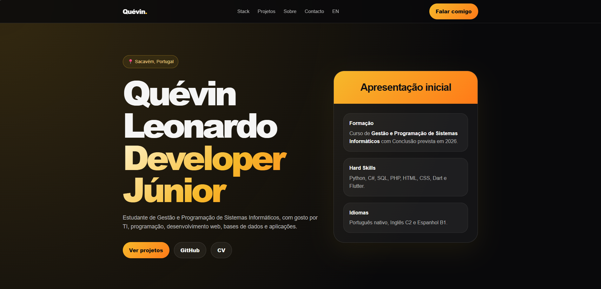

# Quévin Tavares — Portfolio

A bilingual personal portfolio built with HTML, CSS and JavaScript. It brings together my programming, robotics and 3D animation projects, with project pages, videos, event highlights and CVs.

## See it



[Open the portfolio](https://kevinleonardohub.github.io/portfolio/) · [English version](https://kevinleonardohub.github.io/portfolio/en.html)

## Use it locally

From this repository's root, with Python 3 installed:

```bash
python3 -m http.server 8000
```

Open `http://localhost:8000/`. Browse the project cards to see each project's explanation and media; use the EN/PT links to switch language.

## Edit the content

- `index.html` and `en.html`: Portuguese and English homepages.
- `projects/`: individual project pages, including English counterparts.
- `assets/`: images, videos, CVs and supporting files.
- `style.css` and `script.js`: shared homepage styling and behaviour.

Text is written directly into the HTML. Update both language versions when changing content. This is a static site with no package installation or build step; it is hosted on GitHub Pages.

Created by **Quévin Tavares**.
